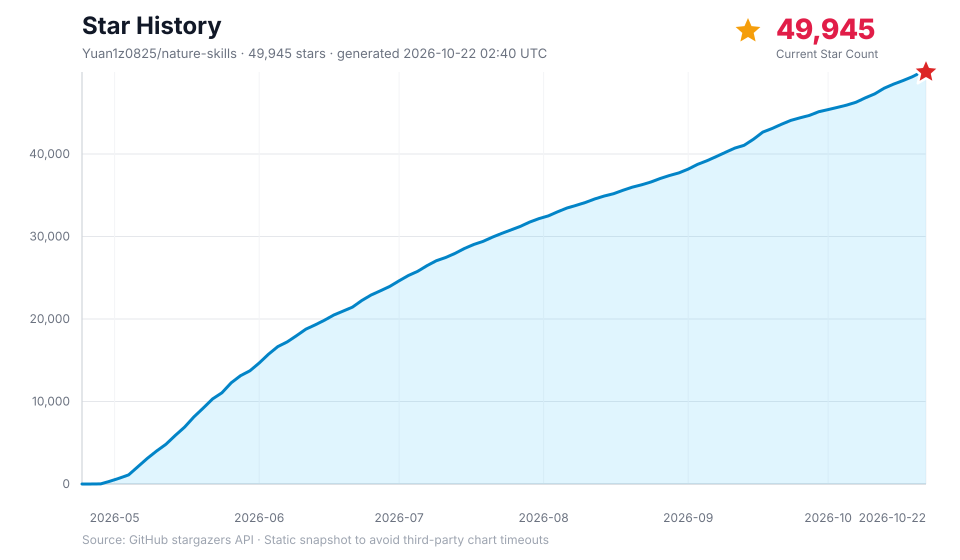

> **本地锂电池版本：** 本目录的技能使用 `lithium-battery-*` 名称。请从本目录安装；下方保留的上游 GitHub 克隆、更新示例会获取原版 Nature Skills。

当前版本仓库：[charlie-sys/lithium-battery-research-skills](https://github.com/charlie-sys/lithium-battery-research-skills)。本项目改编自 [Yuan1z0825/nature-skills](https://github.com/Yuan1z0825/nature-skills)，保留原项目许可与署名。

在 Codex 中直接指定所需技能，例如：`$lithium-battery-polishing`（已有稿件中译英或润色）、`$lithium-battery-writing`（起草章节）、`$lithium-battery-reviewer`（模拟审稿）、`$lithium-battery-citation`（文献支撑核查）、`$lithium-battery-figure`（论文绘图）。`$lithium-battery-paper-trans` 的原有工作流是英文 PDF 翻译为中文 PDF；中文论文译为英文应选 `$lithium-battery-polishing`。`lithium-battery-shared` 为内部支持包，不单独调用。

新增论文或语料、更新领域写作规则及多人协作，请先阅读 [7.4 锂电池语料与技能的协作维护](#74-锂电池语料与技能的协作维护)。该流程使用本仓库地址。

<div align="center">
  <p>
    
  </p>
  <p>
    <a href="LICENSE"></a>
    <a href="#5-安装"></a>
    <a href="#6-技能索引"></a>
    <a href="README_EN.md"></a>
  </p>
  <p>
    <a href="https://yuan1z0825.github.io/nature-skills/">在线网站</a>
    · <a href="#5-安装">立即安装</a>
    · <a href="#4-快速开始">快速开始</a>
    · <a href="#6-技能索引">技能索引</a>
    · <a href="docs/open-source-agent-frameworks.md">其他安装</a>
    · <a href="#7-贡献与开发">贡献方式</a>
    · <a href="README_EN.md">English</a>
  </p>
  <p>
    <b>Nature Skills 网页版：内置 Nature Polishing（论文润色）与 Nature Figure（科研绘图）核心功能，访问地址 <a href="https://natureskills.cn">https://natureskills.cn</a></b>
  </p>
  <a href="https://natureskills.cn">
    
  </a>

</div>


---

> **本地领域化副本：** `nature-skills-lithium-battery-v1` 基于原版 Nature Skills，给全部 23 个技能目录加入按任务触发的锂离子电池状态估计指导。完整语料写作指南见 [`lithium-battery-shared` 中的领域参考文件](skills/lithium-battery-shared/core/battery-state-estimation-writing-style.md)。这不是原项目或目标期刊发布的官方版本；非本领域任务仍按原技能工作流处理。

`nature-skills` 面向全球 AI 学者收录可复用科研技能，强调真实问题解决、可验证工作流与可直接使用的科研产物。

## 目录

- [1. 项目发起人与运营信息](#1-项目发起人与运营信息)
  - [1.1 原项目介绍](#11-原项目介绍)
  - [1.2 当前版本维护人](#12-当前版本维护人)
- [2. Skills 主要开发者](#2-skills-主要开发者)
- [3. 项目理念与社区](#3-项目理念与社区)
- [4. 快速开始](#4-快速开始)
- [5. 安装](#5-安装)
  - [5.1 `npx skills` 安装方式](#51-npx-skills-安装方式)
  - [5.2 Claude Code 安装方式](#52-claude-code-安装方式)
  - [5.3 Codex 安装方式](#53-codex-安装方式)
  - [5.4 Chatbox 安装与使用](#54-chatbox-安装与使用)
  - [5.5 其他 Agent 场景](#55-其他-agent-场景)
- [6. 技能索引](#6-技能索引)
- [7. 贡献与开发](#7-贡献与开发)
  - [7.4 锂电池语料与技能的协作维护](#74-锂电池语料与技能的协作维护)
- [8. Star 历史](#8-star-历史)

## 1. 项目发起人与运营信息

### 1.1 原项目介绍

本项目基于袁一哲发起的 [Nature Skills](https://github.com/Yuan1z0825/nature-skills) 改编。原项目提供可复用的科研技能体系和工作流，为本版本的领域适配奠定基础。本仓库保留原项目的许可与署名；原项目的介绍和运营信息可在其仓库查看。

### 1.2 当前版本维护人

当前锂电池版本由 [charlie-sys](https://github.com/charlie-sys) 负责后续维护，维护仓库为 [lithium-battery-research-skills](https://github.com/charlie-sys/lithium-battery-research-skills)。维护工作包括锂离子电池状态估计语料提炼、领域写作指南更新、技能适配、版本发布与协作审核。

本版本的问题反馈和更新建议通过本仓库的 Issues 或 Pull Request 提交。协作人获得私有仓库访问权限后，可按 [7.4 节](#74-锂电池语料与技能的协作维护)参与维护。

## 2. Skills 主要开发者

原项目的主要开发者包括袁一哲、马昕瑞和胡彬，负责原有技能体系、核心架构及相关科研工作流。原项目贡献者信息以 [Nature Skills 仓库](https://github.com/Yuan1z0825/nature-skills)为准。

在此基础上，当前版本的维护分工如下：

| 维护人 | 当前版本角色 | 主要维护内容 | 协作入口 |
|---|---|---|---|
| **[charlie-sys](https://github.com/charlie-sys)** | 锂电池版本维护人 | 领域语料与写作规范维护、`lithium-battery-*` 技能适配、仓库与 CI 维护、更新审核和版本发布 | [当前仓库](https://github.com/charlie-sys/lithium-battery-research-skills) |

后续协作贡献通过 PR 和提交记录追溯；新增论文、语料和规则时，应同时记录来源、适用范围及验证结果。

## 3. 项目理念与社区

> **来源说明：** 本节保留自 [Nature Skills 原项目](https://github.com/Yuan1z0825/nature-skills)，其中的项目理念、第一人称表述及社区信息均属于原项目团队；“我”“我们”指原文作者或原项目团队。本节用于呈现原项目的设计背景，不代表当前锂电池版本维护人的个人观点；相关陈述的依据与最新社区信息请以原项目为准。

### 3.1 自己的一些浅薄观点

- 最近发现，我设计的 Nature Skills 被谷歌 DeepMind 关注并借鉴，他们参考了其中的引用体系、脚本思路以及技能设计哲学，推出了 Science Skills。说实话，这让我挺欣慰的——当国外的顶尖 AI 机构开始从我们的工作中汲取灵感时，说明中国开发者的原创思想正在被世界看见。这不是被复制的失落，而是中国力量在开源土壤里生根后，自然向外生长出的影响力。
- 我们设计 Skills 的重心，从来不是要求每个人都来啃透这套思想，而是这套思想本身就具备被机器理解并复用的能力。你如果想创立一个全新的 Skill，或者把它适配到自己的专属领域，根本不需要从头学起——直接把 Nature Skills 的 GitHub 地址发给 Codex，它就能自动学习其中的设计精髓，帮你完成新 Skill 的创建和修改。这才是思想的真正解放：它不再依赖口口相传，而是通过 AI 直接流淌进每一个需要它的角落。
- Nature Skills 真正的价值，或许并不在于那些具体的技能模块，而在于它悄悄推开了一扇新的大门——它让很多人第一次意识到，原来可以借助 Codex 或智能体来操控本地电脑做科研。我有幸见证并陪伴了许多人完成科研范式的转变。当他们惊叹“原来科研还可以这样去做”的那一刻，这种认知上的破壁和解放，远比 Skills 本身更让我觉得有意义。它不是一个工具的成功，而是一种新的思考方式开始在人群中蔓延。
- 在当下，几乎所有实用的工具都可以被提炼为标准化流程，而标准化流程恰好可以封装成可复用技能。

### 3.2 视频教程与社区

以下教程、社群入口和联系方式来自原项目团队，指向原项目的社区资源；当前版本的维护协作请通过本仓库的 Issues 或 Pull Request 进行。入口是否仍有效，请以原项目最新说明为准。

<table>
  <tr>
    <td align="center">
      <b>视频教程请关注抖音</b><br>
      
    </td>
    <td align="center">
      <b>Agent 科研交流群</b><br>
      
    </td>
    <td align="center">
      <b>添加个人微信请备注来意</b><br>
      
    </td>
  </tr>
</table>

## 4. 快速开始

安装完成后，可以直接把论文、段落、审稿意见或任务描述交给 Agent。下面这些提示词可以直接复制使用：

| 想做什么 | 直接这样说 |
|---|---|
| 读论文 / 中英文对照 | `把这篇 PDF 做成图文对应的中英文对照 Markdown reader。` |
| 生成文献汇报 PPT | `把这篇论文做成中文组会汇报 PPT，保留关键图件和来源标注。` |
| 润色或翻译论文段落 | `把这段中文改写成 Nature 风格英文，保持学术含义不变。` |
| 写摘要、引言或讨论 | `根据这些结果和图件，帮我起草 Nature 风格的摘要和引言。` |
| 预投稿审稿模拟 | `从 Nature 审稿人视角评估这篇稿件，给出三份互盲 reviewer reports；全部定稿后再综合。` |
| 回复审稿意见 | `根据这封返修邮件，为每位互盲审稿人分别写逐点回复和 cover letter，并标出修改稿需要标红的位置。` |
| 查文献、他引和引用者画像 | `整理这篇文章的引用数、严格他引数、DOI，并看引用者里有没有院士、Fellow 或领域大牛。` |
| 做科研图或论文示意图 | `根据这段方法和结果，帮我生成投稿级科研图或论文示意图草稿。` |

如果你不确定该用哪个技能，直接描述任务即可；如果已经知道技能名，可以在提示词中明确写“使用 `lithium-battery-reader`”或“使用 `lithium-battery-response`”。

## 5. 安装

`nature-skills` 是一组围绕 `SKILL.md` 组织的可复用技能包。`skills/` 下的每个顶层技能目录都是一个可安装单元，例如 `nature-*`；`lithium-battery-shared` 是供其他技能读取的共享支持包，默认不作为独立触发技能计入技能索引。

### 5.1 `npx skills` 安装方式

需要先安装 [Node.js 18 或更高版本](https://nodejs.org/)。无需全局安装 CLI；先查看仓库中可安装的技能名：

```bash
npx skills add Yuan1z0825/nature-skills --list
```

优先按当前任务选择需要的技能，并保留其共享依赖。只为当前项目安装时，省略 `--global`；需要跨项目使用时再加上它。例如：

```bash
npx skills add Yuan1z0825/nature-skills --agent codex --skill lithium-battery-figure --yes --copy
```

单独安装 `lithium-battery-reader`、`lithium-battery-paper2ppt`、`lithium-battery-polishing` 或 `lithium-battery-writing` 时，同时选择共享支持包：

```bash
npx skills add Yuan1z0825/nature-skills --global --agent codex \
  --skill lithium-battery-reader --skill lithium-battery-shared --yes --copy
```

如果确实需要完整技能集，也可以全局安装到 Codex。全量选择包含 `lithium-battery-shared`：

```bash
npx skills add Yuan1z0825/nature-skills --global --agent codex --skill '*' --yes --copy
```

需要把全部技能安装到 CLI 支持的所有 agent 时，使用：

```bash
npx skills add Yuan1z0825/nature-skills --all
```

检查全局安装结果并更新：

```bash
npx skills list --global --agent codex --json
npx skills update --global --yes
```

只更新一个技能，或只更新当前项目中的技能：

```bash
npx skills update lithium-battery-reader --global --yes
npx skills update --project --yes
```

技能选择参数使用 `--list` 显示的 frontmatter 名称；例如目录 `lithium-battery-proposal-writer` 当前显示为 `lithium-battery-proposal-writer`。`npx skills` 管理的是技能文件，Python、R、浏览器或 MCP 等可选运行依赖仍需按下文说明单独配置。

### 5.2 Claude Code 安装方式

Claude Code 不能直接使用 `scripts/update-codex-skills.sh`，因为这个脚本只负责同步到 Codex 的 `~/.codex/skills/`。用于 Claude Code 时，推荐保留一个稳定的本地 clone，再用 subagent 或 slash command 指向真实的 `skills/*/SKILL.md`。这样不会破坏技能目录结构，也能继续读取 `references/`、`static/`、`manifest.yaml`、脚本、资产和 `skills/lithium-battery-shared/`。

如果还没有安装 Claude Code：

```bash
npm install -g @anthropic-ai/claude-code
claude
```

先把仓库 clone 到一个稳定路径：

```bash
mkdir -p ~/ai-skills
cd ~/ai-skills
git clone https://github.com/Yuan1z0825/nature-skills.git
```

推荐方式：为常用技能创建 Claude Code subagent wrapper。以 `lithium-battery-reader` 为例：

```bash
mkdir -p ~/.claude/agents
cat > ~/.claude/agents/lithium-battery-reader.md <<'EOF'
---
name: lithium-battery-reader
description: Use for Chinese-English paper reading, figure-aware translation, and source-grounded paper notes.
---

When invoked, first read `~/ai-skills/nature-skills/skills/lithium-battery-reader/SKILL.md` and follow it as the governing workflow.
Read supporting files from `~/ai-skills/nature-skills/skills/lithium-battery-reader/` and `~/ai-skills/nature-skills/skills/lithium-battery-shared/` only when needed.
Do not replace this skill with a generic paper-reading response.
EOF
```

然后开启新的 Claude Code 会话，直接请求使用这个 subagent：

```text
Use the lithium-battery-reader subagent to turn this paper into a Chinese-English Markdown reader.
```

如果你更喜欢 slash command，也可以创建命令 wrapper：

```bash
mkdir -p ~/.claude/commands
cat > ~/.claude/commands/lithium-battery-reader.md <<'EOF'
Read `~/ai-skills/nature-skills/skills/lithium-battery-reader/SKILL.md` first and follow it strictly.
Read directly needed supporting files from `~/ai-skills/nature-skills/skills/lithium-battery-reader/` and `~/ai-skills/nature-skills/skills/lithium-battery-shared/`.

$ARGUMENTS
EOF
```

在 Claude Code 中使用：

```text
/lithium-battery-reader 把这篇论文做成中英文对照的完整 Markdown reader。
```

安装其他技能时，把示例中的 `lithium-battery-reader` 换成对应目录名即可，例如 `lithium-battery-polishing`、`lithium-battery-writing`、`lithium-battery-reviewer`、`lithium-battery-response` 或 `lithium-battery-figure`。后续更新只需要：

```bash
cd ~/ai-skills/nature-skills
git pull
```

只要 wrapper 仍然指向这个稳定 clone 路径，就不需要重复复制技能文件。

**自动更新（可选）**

如果你希望 Claude Code 每次开启会话时自动拉取上游更新，可以用 `scripts/autoupdate-skills.sh` 配合一个 `SessionStart` 钩子。

这套方式把技能**直接复制**进 `~/.claude/skills/`（Claude Code 会自动发现该目录，技能以目录名直接加载），而不是使用上面的 wrapper。两种方式二选一即可。

先保留一个**专用**的稳定 clone（只用于同步技能，请不要在里面做开发提交）：

```bash
mkdir -p ~/ai-skills
git clone https://github.com/Yuan1z0825/nature-skills.git ~/ai-skills/nature-skills
```

首次安装，把技能复制进 Claude Code 的技能目录：

```bash
~/ai-skills/nature-skills/scripts/autoupdate-skills.sh --force
```

然后在 `~/.claude/settings.json` 里加一个 `SessionStart` 钩子（若已有 `hooks`，把这一项合并进去，不要整体覆盖）：

```json
{
  "hooks": {
    "SessionStart": [
      {
        "hooks": [
          {
            "type": "command",
            "command": "$HOME/ai-skills/nature-skills/scripts/autoupdate-skills.sh",
            "async": true,
            "timeout": 120
          }
        ]
      }
    ]
  }
}
```

`async: true` 让它在后台运行、不阻塞启动。脚本自带保护：默认 1 小时内不重复联网检查、断网或拉取失败自动跳过（`exit 0`，绝不卡住会话）、上游变化或安装目录发生漂移时重新同步、并且拒绝在有未提交改动的 clone 上强行前进。拉到的新版会在**下一次**开启会话时生效（当前会话的技能已经加载完毕）。每个安装目标使用独立日志，路径为 `~/.local/state/nature-skills/<目标目录编号>/autoupdate.log`。

目标目录与检查频率都可配置：

```bash
# 默认同步到 ~/.claude/skills；用 --dest 指到别处，例如 Codex：
~/ai-skills/nature-skills/scripts/autoupdate-skills.sh --dest ~/.codex/skills
# 最多每小时联网检查一次；每次运行仍会校验本地安装：
~/ai-skills/nature-skills/scripts/autoupdate-skills.sh --throttle 3600
```

### 5.3 Codex 安装方式

需要安装或更新完整技能集时，可以使用仓库自带脚本。脚本会同步 `skills/` 下所有顶层技能目录，并在复制后做 `diff` 验证；它不会覆盖其他无关 Codex skills。只需要部分技能时，使用上面的 `npx skills` 按需安装方式。

```bash
git clone https://github.com/Yuan1z0825/nature-skills.git
cd nature-skills
scripts/update-codex-skills.sh --pull
```

如果已经 clone 过仓库：

```bash
cd nature-skills
scripts/update-codex-skills.sh --pull
```

验证当前 Codex 安装是否和这个 checkout 一致：

```bash
scripts/update-codex-skills.sh --check
```

如果你长期用这个脚本更新，并希望清理上游已经删除的旧技能目录：

```bash
scripts/update-codex-skills.sh --pull --prune
```

`--prune` 只会删除以前由这个脚本记录过、但当前仓库已经不再包含的目录。第一次运行没有历史记录时，它不会猜测删除旧目录。

也可以把仓库链接交给 Codex，让 Codex 执行安装脚本。推荐提示词：

```text
请从这个仓库安装 Codex skills：
https://github.com/Yuan1z0825/nature-skills.git

请 clone 仓库后运行 scripts/update-codex-skills.sh --pull。
安装后再运行 scripts/update-codex-skills.sh --check 验证。
请保留 skills/ 下的完整技能目录，不要只复制 SKILL.md。
```

如果只安装单个技能，请明确说明技能名：

```text
只安装这个仓库里的 lithium-battery-reader：
https://github.com/Yuan1z0825/nature-skills.git

如果该技能需要共享文件，也请一并安装 skills/lithium-battery-shared。
```

关键规则：保留完整目录结构。请复制或引用整个技能文件夹，而不是只复制 `SKILL.md`，因为许多技能依赖 `references/`、`static/`、`manifest.yaml`、脚本、资产或共享文件。

安装脚本不会自动安装 Python 依赖。需要使用相关脚本或 MCP 服务时，再按需安装：

```bash
python -m pip install -r skills/lithium-battery-paper-to-patent/requirements.txt
python -m pip install -r skills/lithium-battery-paper-to-patent/scripts/disclosure/requirements-cnipa.txt  # 可选：国知局公布公告检索
python -m pip install -r skills/lithium-battery-academic-search/mcp-server/requirements.txt
```

如果启用 `lithium-battery-paper-to-patent` 的国知局公布公告检索，还需要执行 `python -m playwright install chromium`。

`lithium-battery-academic-search` 的 MCP 服务还需要单独配置 `PUBMED_EMAIL`，Scopus / ScienceDirect 等可选 provider 需要使用本机凭据配置，不要把 API key 写入仓库文件。

安装后，请开启一个新的 Codex 会话，然后自然描述任务，例如：

```text
把这篇论文做成中英文对照的完整 Markdown reader。
```

```text
把这篇论文做成中文PPT。
```

如果你使用 OpenClaw、OpenCode、Hermes 等开源 agent / 编程框架，请看 [OpenClaw / OpenCode / Hermes 接入教程](docs/open-source-agent-frameworks.md)。

**自动更新（可选）**

Codex 支持全局 `SessionStart` hook。保留一个专用 clone 后，可以在每次启动或恢复 Codex 会话时检查更新，并把新版同步到 `~/.codex/skills/`。

先创建专用 clone 并完成首次同步：

```bash
mkdir -p ~/.codex
git clone https://github.com/Yuan1z0825/nature-skills.git ~/.codex/.nature-skills-src
~/.codex/.nature-skills-src/scripts/autoupdate-skills.sh \
  --dest ~/.codex/skills --force
```

然后创建或合并 `~/.codex/hooks.json`：

```json
{
  "hooks": {
    "SessionStart": [
      {
        "matcher": "startup|resume",
        "hooks": [
          {
            "type": "command",
            "command": "/bin/bash \"$HOME/.codex/.nature-skills-src/scripts/autoupdate-skills.sh\" --dest \"$HOME/.codex/skills\"",
            "timeout": 120,
            "statusMessage": "Checking Nature Skills updates"
          }
        ]
      }
    ]
  }
}
```

若 `hooks.json` 中已有其他 hook，请合并 `SessionStart` 项，不要整体覆盖。首次启用或修改 hook 后，在 Codex 中运行 `/hooks` 检查并信任它。Codex 当前按同步方式执行 command hook，因此这里依靠脚本自带的 1 小时节流、60 秒网络保护和断网自动跳过，避免每次会话都重复联网或因更新失败阻断启动。即使上游版本未变化，脚本也会验证安装目录并在发现漂移时重新同步。

每个安装目标使用独立日志，路径为 `~/.local/state/nature-skills/<目标目录编号>/autoupdate.log`。拉取到的新技能通常在下一次会话中完整生效。

### 5.4 Chatbox 安装与使用

[Chatbox](https://chatboxai.app/zh) 桌面版提供图形化 Skills 管理界面。请使用带有「设置 → 技能（Skills）」入口的版本；本节适用于桌面端。

**从 GitHub 安装**

1. 打开 Chatbox 的「设置 → 技能」，点击「从 GitHub 安装」。
2. 粘贴 `https://github.com/Yuan1z0825/nature-skills`，点击「扫描」。
3. 勾选需要的技能，点击「安装已选」。初次体验可选择 `lithium-battery-polishing` 和 `lithium-battery-shared`；需要整套技能时可以「全选」。
4. 在「已安装技能」中确认安装结果，并确认需要使用的技能已启用。

`lithium-battery-shared` 是共享支持包。使用 `lithium-battery-polishing`、`lithium-battery-writing`、`lithium-battery-response`、`lithium-battery-reader` 或 `lithium-battery-paper2ppt` 等引用它的技能时，需要一并安装；它不作为独立任务调用。安装单个技能不会自动补齐其他技能依赖。列表可能显示技能的 frontmatter 名称，例如 `lithium-battery-proposal-writer` 显示为 `lithium-battery-proposal-writer`。

**开始使用**

新建对话，选择支持工具调用的模型，开启「智能体模式（Agent Mode）」。把待处理文本粘贴到对话中，并明确写出技能名。例如：

```text
请使用 lithium-battery-polishing，把下面这段中文改写为 Nature 风格英文。
保持原有学术含义、数值和结论边界，列出主要修改及理由：

[在这里粘贴论文段落]
```

需要读论文时，可安装 `lithium-battery-reader` 和 `lithium-battery-shared`，提供论文文件或可访问的本地路径，再请求：

```text
请使用 lithium-battery-reader，把这篇论文做成图文对应的中英文对照 Markdown reader，
保留公式和来源锚点，并将产物保存到我指定的输出目录。
```

检查对话中的技能加载和工具执行记录，确认实际加载了所需技能。若未触发，先检查技能开关、智能体模式以及当前模型是否支持工具调用。

**运行依赖与更新**

Skills 安装的是指令和配套文件。Python/R、PDF/PPTX 工具、浏览器和 MCP 服务等运行依赖仍需按具体技能说明配置；涉及本地文件或脚本时，按 Chatbox 提示授权所需目录和命令。生成图片等外部服务需要对应服务的凭据。安装成功不代表这些外部能力已配置完成。

在技能的操作菜单中可「检查更新」并按提示更新；有共享依赖时也要检查 `lithium-battery-shared`。如果 GitHub 扫描或下载失败，可从本仓库的「Code → Download ZIP」下载并解压，点击 Chatbox 的「打开技能文件夹」，将所需的完整技能目录及 `lithium-battery-shared` 放到该文件夹的同一级，然后刷新技能列表并启用。保留 `references/`、`static/`、脚本和资产；不要只复制 `SKILL.md`。手动复制时，目录名应与 `SKILL.md` 中的 `name` 一致（例如将 `lithium-battery-proposal-writer` 目录命名为 `lithium-battery-proposal-writer`）。手动复制的技能需要手动更新。

### 5.5 其他 Agent 场景

OpenClaw、OpenCode、Hermes 的具体接入方式见 [OpenClaw / OpenCode / Hermes 接入教程](docs/open-source-agent-frameworks.md)。

用于其他 agent 时，建议保留一个稳定的仓库 clone，再创建轻量 subagent、slash command 或 custom prompt wrapper，指向真实的 `skills/*/SKILL.md`，并保留 `skills/lithium-battery-shared/`。

手动或其他 agent 使用时：

1. 将完整技能目录复制到你的 prompt library 或项目中。
2. 保留 `SKILL.md`、`manifest.yaml`、`static/`、`references/`、脚本、资产和需要的 `skills/lithium-battery-shared/` 文件。
3. 如目标 agent 有自己的格式要求，可调整 frontmatter 和正文结构。

## 6. 技能索引

当前 `skills/` 下包含以下可触发技能；`skills/lithium-battery-shared/` 是共享内容目录，不计入技能索引。点击技能名或“详情页”可以进入每个 skill 的单独说明页面。

| 技能 | 状态 | 用途 | 触发词 | 详情页 |
|-------|--------|---------|-----------------|--------|
| [`lithium-battery-figure`](skills/lithium-battery-figure/README.md) | Stable | 面向 Nature / 高影响力期刊的 Python 或 R 投稿级科研图工作流，包含 Results 级多面板证据架构、渲染时子图对齐门、最终 PDF 自动文字/图形碰撞审计、第三方 figures4papers 参考示例、原创模板和 OpenRouter GPT Image 2 论文示意图草稿 | “Nature figure”, “投稿级图片”, “publication plot”, “scientific figure”, “figures4papers”, “论文示意图”, “GPT Image 2” | [详情](skills/lithium-battery-figure/README.md) |
| [`lithium-battery-polishing`](skills/lithium-battery-polishing/README.md) | Stable | 将学术文本润色、重构或翻译为 Nature 风格英文，并扫描全文术语、单位、数值精度和声称漂移 | “Nature style”, “润色”, “academic writing”, “论文英文” | [详情](skills/lithium-battery-polishing/README.md) |
| [`lithium-battery-writing`](skills/lithium-battery-writing/README.md) | Draft | 起草 Nature 风格手稿章节，并重建论文论证 | “Nature writing”, “写摘要”, “写引言”, “manuscript draft”, “论文写作” | [详情](skills/lithium-battery-writing/README.md) |
| [`lithium-battery-reviewer`](skills/lithium-battery-reviewer/README.md) | Draft | 从审稿人视角模拟 Nature 风格评审，输出三份互盲 reviewer reports、分级 Major/Minor 意见，并检查手稿内部一致性 | “Nature reviewer”, “预投稿评审”, “reviewer report”, “审稿人视角评估” | [详情](skills/lithium-battery-reviewer/README.md) |
| [`lithium-battery-citation`](skills/lithium-battery-citation/README.md) | Beta | 检索严格限定在 Nature / CNS 系列的支撑文献，并导出 ENW、RIS 或 Zotero RDF | “Nature citation”, “CNS citation”, “分段引用”, “支撑文献”, “Zotero RDF” | [详情](skills/lithium-battery-citation/README.md) |
| [`lithium-battery-data`](skills/lithium-battery-data/README.md) | Draft | 准备 Data Availability statement、数据仓储方案和 FAIR 检查 | “Data Availability”, “数据可用性”, “repository”, “FAIR metadata” | [详情](skills/lithium-battery-data/README.md) |
| [`lithium-battery-statistics`](skills/lithium-battery-statistics/README.md) | Draft | 审查、改写或起草统计报告，覆盖实验单位、重复数、p 值、多重比较、效应量、置信区间、图注统计和跨章节数值一致性 | “Nature statistics”, “统计审查”, “statistical analysis”, “p value”, “sample size”, “replicates”, “multiple comparisons”, “图注统计”, “统计分析小节” | [详情](skills/lithium-battery-statistics/README.md) |
| [`lithium-battery-reader`](skills/lithium-battery-reader/README.md) | Beta | 生成带来源锚点、图文对应、公式渲染和中英文对照的全文 Markdown reader | “nature reader”, “全文 Markdown”, “原文对照”, “图文对应”, “公式渲染”, “全文翻译” | [详情](skills/lithium-battery-reader/README.md) |
| [`lithium-battery-paper-xray`](skills/lithium-battery-paper-xray/README.md) | Beta | 把一篇论文读到能复述作者的推理：还原真实的出发点、分清承重设计与装饰、公式落到能手算的例子、核对证据边界 | “精读论文”, “讲透这篇论文”, “作者为什么这么设计”, “这个公式怎么推出来的”, “paper x-ray” | [详情](skills/lithium-battery-paper-xray/README.md) |
| [`lithium-battery-paper-trans`](skills/lithium-battery-paper-trans/README.md) | Beta | 将英文论文 PDF 全文或指定页逐页生图翻译，对照检查后交付保留源页尺寸的中文图片型 PDF；A4 按需指定 | “论文翻译”, “翻译论文 PDF”, “nature paper trans” | [详情](skills/lithium-battery-paper-trans/README.md) |
| [`lithium-battery-paper-card`](skills/lithium-battery-paper-card/README.md) | Beta | 精读单篇论文并生成有来源约束的 01–16 节 Paper Card，覆盖方法逻辑、实验—结论证据链、结论边界、批判性分析和可检验研究想法 | “nature paper card”, “论文精读”, “Paper Card”, “证据链”, “结论边界” | [详情](skills/lithium-battery-paper-card/README.md) |
| [`lithium-battery-response`](skills/lithium-battery-response/README.md) | Beta | 解析返修邮件，为互盲审稿人分别生成独立回复，并提供 cover letter、标红稿、LaTeX 模板和返修包一致性检查 | “response to reviewers”, “rebuttal letter”, “cover letter”, “major revision”, “返修邮件”, “审稿意见回复”, “修回信”, “LaTeX 模板” | [详情](skills/lithium-battery-response/README.md) |
| [`lithium-battery-paper2ppt`](skills/lithium-battery-paper2ppt/README.md) | Beta | 从科研论文生成中文 PPTX 文献汇报 deck | “paper PPT”, “journal club”, “paper to slides”, “论文汇报” | [详情](skills/lithium-battery-paper2ppt/README.md) |
| [`lithium-battery-image2ppt`](skills/lithium-battery-image2ppt/README.md) | Beta | 将幻灯片图片、扫描 PDF 和图片型 PPTX 重建为对象级可编辑 PowerPoint，并执行渲染 QA | “图片转可编辑PPT”, “截图还原PPT”, “扫描PDF转PPTX”, “image to editable PowerPoint” | [详情](skills/lithium-battery-image2ppt/README.md) |
| [`lithium-battery-paper-to-patent`](skills/lithium-battery-paper-to-patent/README.md) | Beta | 从论文、技术报告或项目材料生成有证据约束的中国发明专利草稿，并支持专利点挖掘、查新和技术交底书迭代 | “paper to patent”, “Chinese patent”, “论文转专利”, “权利要求书”, “技术交底书”, “专利点” | [详情](skills/lithium-battery-paper-to-patent/README.md) |
| [`lithium-battery-ref-verifier`](skills/lithium-battery-ref-verifier/README.md) | Stable | 参考文献多源交叉验证：逐字段对比作者/标题/年份/卷期/页码，标记卷年冲突、作者编造、页码偏差等 | “verify refs”, “校验文献”, “check references”, “文献验证”, “ref check” | [详情](skills/lithium-battery-ref-verifier/README.md) |
| [`lithium-battery-academic-search`](skills/lithium-battery-academic-search/README.md) | Beta | 多源文献检索、引用核验、严格他引审计、文章引用指标表、高影响力引用者画像和参考文献管理 | “search papers”, “find articles”, “literature search”, “查文献”, “verify DOI”, “严格他引”, “文章引用表”, “引用我的文章的人有没有大牛” | [详情](skills/lithium-battery-academic-search/README.md) |
| [`lithium-battery-downloader`](skills/lithium-battery-downloader/README.md) | Beta | 通过图书馆资源入口、Chrome 登录态和开放获取路径合法获取学术全文/PDF | “download papers”, “图书馆下载文献”, “CARSI”, “Web of Science”, “PDF 下载” | [详情](skills/lithium-battery-downloader/README.md) |
| [`lithium-battery-literature-pipeline`](skills/lithium-battery-literature-pipeline/README.md) | Stable | 自动化文献发现管线：多源检索、六维评分、精读推送和本地归档 | “literature pipeline”, “每日文献”, “文献推送”, “daily literature push”, “cron” | [详情](skills/lithium-battery-literature-pipeline/README.md) |
| [`lithium-battery-experiment-log`](skills/lithium-battery-experiment-log/README.md) | Draft | 标准化记录实验图片、语音和文字材料，生成带 YAML frontmatter 的 Obsidian 实验日志并归档原始材料 | “实验日志”, “记录实验”, “experiment log”, “Obsidian vault”, “飞书科研群” | [详情](skills/lithium-battery-experiment-log/README.md) |
| [`lithium-battery-proposal-writer`](skills/lithium-battery-proposal-writer/README.md) | Beta | proposal-first 科研写作状态机，先建立证据、论证和章节契约，再起草或审查文本 | “lithium-battery-proposal-writer”, “proposal”, “开题报告”, “研究方案”, “科研写作 QA” | [详情](skills/lithium-battery-proposal-writer/README.md) |
| [`lithium-battery-social-science`](skills/lithium-battery-social-science/README.md) | Draft | 社科及相邻学科学术写作与选题论证工作台：选题构思、文献版图、证据路线与主张上限、新颖性审计、可行性评估、诚实表述自检 | “社科论文”, “选题”, “research question”, “文献综述”, “开题”, “过度断言” | [详情](skills/lithium-battery-social-science/README.md) |

## 7. 贡献与开发

### 7.1 共享设计原则

所有技能都遵守以下原则：

1. **优先使用一手来源**：规则基于已发表 Nature 内容、官方期刊指南或明确的本地来源，而不是泛泛审美偏好。
2. **显式胜过隐式**：每条规则都应说明理由，而不是只给断言。
3. **感知章节与任务上下文**：学术写作、图件、引用和回复都依赖上下文；不同论文部分使用不同逻辑。
4. **输出优先**：每个技能都应返回能直接使用的产物，例如可粘贴文本、`.svg`、`.pptx`、`.docx` 或具体建议。
5. **可扩展**：每个技能自包含在自己的目录中，新增技能不应要求修改既有技能。

### 7.2 仓库目录结构

```text
skills/
├── lithium-battery-shared/              # 当技能引用 ../lithium-battery-shared 时需要保留
├── lithium-battery-<topic>/
│   ├── README.md
│   ├── README_EN.md
│   ├── SKILL.md
│   ├── manifest.yaml     # router-style 技能会包含
│   ├── static/           # router-style 技能会包含
│   └── references/...
└── lithium-battery-proposal-writer/
    ├── README.md
    ├── README_EN.md
    ├── SKILL.md
    ├── scripts/...
    ├── templates/...
    └── references/...
```

### 7.3 新增技能流程

向本仓库添加技能时，请按以下流程：

**1. 创建技能目录**

```text
skills/lithium-battery-<topic>/
```

**2. 添加必需文件**

| 文件 | 是否必需 | 用途 |
|------|----------|------|
| `SKILL.md` | 必需 | frontmatter（`name`、`description`）+ 规则 + 工作流；触发后由 agent 加载 |
| `README.md` | 必需 | 面向人的中文说明文档 |
| `README_EN.md` | 必需 | 与中文详情页配套的英文说明文档 |
| `references/*.md` | 复杂技能推荐 | 模块化规则文件，例如 API、设计理论、教程、图表类型等 |

**3. 编写中英文 README**

每个新增技能都必须同时提供 `README.md` 和 `README_EN.md`。README 是面向人的技能入口页，不是 `SKILL.md` 的重复版，也不是安装手册。它的目标是让用户在 30 秒内判断：这个 skill 能不能解决我的问题、我要给它什么、它会产出什么、边界在哪里。

基本规则：

- 中文 README 和英文 README 必须一一镜像：标题数量一致、顺序一致、信息点一致；英文页不要写成另一套独立模板。
- 顶部固定为技能名、语言切换链接和一句定位说明。
- 默认使用下面的基础结构；只有确实需要时才插入可选章节。
- 不要在单个 skill README 中重复仓库安装教程、作者信息、变更日志、开发过程、完整文件树或大段内部实现细节。
- 复杂规则、API 参数、长教程、脚本说明和模板索引应放进 `references/`、`static/`、`scripts/` 或 `SKILL.md`，README 只保留路标。
- 如果技能有视觉资产，可以放一个小型预览表；不要把 README 变成大型图库或长篇技术手册。

中文 README 基础结构：

```markdown
# `lithium-battery-<topic>` 技能

[English](README_EN.md)

一句话说明这个技能的定位、主要任务和使用边界。

## 适合用它做什么
## 典型请求
## 你需要提供
## 产出
## 边界
## 相关技能
```

英文 README 必须对应为：

```markdown
# `lithium-battery-<topic>` Skill

[中文说明](README.md)

One sentence describing the skill's role, main task, and usage boundary.

## What To Use It For
## Typical Requests
## What You Need To Provide
## Outputs
## Boundaries
## Related Skills
```

可选章节必须中英文同步插入，并保持相同顺序。常见可选章节包括：

| 中文章节 | 英文章节 | 使用场景 |
|----------|----------|----------|
| `## 工作方式` | `## Workflow` | 需要解释核心流程或路由方式 |
| `## 运行和依赖` | `## Runtime and Dependencies` | 有脚本、MCP、API key、本地配置或外部依赖 |
| `## 示例预览` | `## Example Preview` | 有少量图件、截图或可视化资产值得展示 |
| `## 内置参考` | `## Built-In References` | 需要指向 `references/`、`assets/` 或 demo |
| `## 方法来源` | `## Method Sources` | 写作、审查或分析规则来自特定来源 |
| `## 三种模式` | `## Three Modes` | 技能有清晰的 compose/revise/hybrid 等模式 |
| `## 与 ... 的关系` | `## Relationship With ...` | 容易和另一个技能混淆，需要说明分工 |

提交前至少做这些 README 检查：

```bash
python scripts/validate-readmes.py
git diff --check
for d in skills/lithium-battery-*; do
  [ -f "$d/README.md" ] && [ -f "$d/README_EN.md" ] || continue
  rg -q '^\[English\]\(README_EN\.md\)$' "$d/README.md"
  rg -q '^\[中文说明\]\(README\.md\)$' "$d/README_EN.md"
  test "$(rg -c '^## ' "$d/README.md")" = "$(rg -c '^## ' "$d/README_EN.md")"
done
```

**4. 录制使用教程**

提交 PR 时，请同时录制一个简短的使用教程，说明这个 skill 解决什么问题、如何触发、需要什么输入，以及会产出什么结果。可以在 PR 描述中附上视频、录屏链接或可公开访问的教程地址。

**5. 配置 `SKILL.md` frontmatter**

```yaml
---
name: lithium-battery-<topic>
description: >-
  用一句话说明这个技能做什么、什么时候触发、主要输出格式和核心使用场景。
---
```

**6. 更新技能索引**

在上方 [技能索引](#6-技能索引) 表格中添加一行：

```markdown
| [`lithium-battery-<topic>`](skills/lithium-battery-<topic>/README.md) | Draft / Stable | 一句话用途 | 触发词 | [详情](skills/lithium-battery-<topic>/README.md) |
```

**7. 设置状态标签**

| 标签 | 含义 |
|-------|------|
| `Draft` | 规则已定义，但尚未在真实案例上测试 |
| `Beta` | 已在示例上测试，仍可能存在边界问题 |
| `Stable` | 已在真实学术内容上验证，规则相对稳定 |

---

### 7.4 锂电池语料与技能的协作维护

本节适用于更新已有 `lithium-battery-*` 技能。仓库目前为私有，协作人先由仓库所有者邀请并取得访问权限；每人使用自己的 GitHub 账号和本地克隆，通过分支和 Pull Request（PR）提交修改。上节针对**新增技能**的教程要求不作为普通语料更新的必需步骤。

**1. 从当前仓库建立工作分支**

首次协作：

```bash
git clone https://github.com/charlie-sys/lithium-battery-research-skills.git
cd lithium-battery-research-skills
git switch -c corpus/add-soh-papers-20261023
```

已有克隆时，先提交或妥善保存本地修改，再执行：

```bash
git switch main
git pull --ff-only origin main
git switch -c corpus/add-soh-papers-20261023
```

分支名按主题和日期调整。`origin` 应指向 `charlie-sys/lithium-battery-research-skills`；`upstream` 若存在，用于参考原项目。用 `git remote -v` 核对地址。

**2. 提供语料并记录来源**

将合法取得的 PDF 或文本放在本地仓库之外，例如相邻的 `battery-corpus/incoming/`。仓库维护提炼规则和来源记录；仅在确认许可及团队分享权限后提交原文。检查待提交文件，避免混入未公开稿件、个人信息或凭据。

每批更新建议新增 `skills/lithium-battery-shared/references/corpus-updates/YYYY-MM-DD-topic.md`，记录：

- 论文标题、作者、年份、期刊、DOI/出版商链接、读取版本和日期；已存在的 DOI 不重复计入篇数。
- 任务范围：SOC、SOH、容量、衰退或 RUL，以及电芯/电池包、实验室/现场等条件。
- 提炼的表达功能、所在章节及 PDF 页码或小节位置；以自己的话归纳，例句重新撰写。
- 与原指南一致、补充或冲突的内容，适用范围，以及拟修改的技能文件。

保留“原有 48 篇核心语料”与新增补充语料的区别。只有完成去重和实际阅读后才更新总数，并同步检查相关的篇数说明。单篇用法标记为示例；“常用”“更偏好”等判断应有跨论文证据。语料习惯与官方要求冲突时，核对目标期刊当前作者指南，记录来源与核对日期。

**3. 更新共享指南和实际执行规则**

| 文件或位置 | 何时修改 |
|---|---|
| [领域写作指南](skills/lithium-battery-shared/core/battery-state-estimation-writing-style.md) | 新增或修正术语、时态、语态、句式、结果、机制及验证边界；在语料锚点中关联新来源记录。 |
| [领域路由文件](skills/lithium-battery-shared/core/battery-domain-overlay.md) | 指南新增部分或适用任务改变，需要调整其他技能读取哪些内容时。 |
| `skills/lithium-battery-writing/`、`skills/lithium-battery-polishing/` 等受影响技能 | `static/`、`references/` 中有与新指南冲突的直接指令，或确实需要新增任务规则时。 |
| `skills/lithium-battery-shared/journal-formats/` | 官方期刊要求有已核实变化时，注明依据及核对日期。 |

仓库内的领域写作指南是本版本的维护入口。项目工作目录中另存的 `battery_state_estimation_writing_style.md` 不会自动同步到仓库；如需保留该副本，应同步正文规则，并保留两者各自可用的本地文件链接或 DOI 链接。安装到用户目录的副本也不会因仓库编辑而自动更新。

共享指南由各技能通过领域路由读取，普通语料更新通常无需重复修改全部 `SKILL.md`。新增引用文件应从指南或对应技能链接，并说明何时读取；避免堆放不会被读取的材料。保留科学含义与证据边界，不把某篇论文的表达变成所有任务必须遵守的规则。

可在 Codex 中提供以下请求，并替换方括号内容：

```text
使用 skill-creator 更新当前 lithium-battery 技能仓库。
新增语料：[PDF/文本的绝对路径，或论文 DOI/链接]。
提炼范围：[术语、动词、主语、语态、句式、章节时态、结果或机制表达]。
请阅读原共享指南和新语料，记录来源及页码，区分原有核心语料与新增语料，
仅把有依据的归纳写入共享指南，并修正受影响技能中的冲突指令。
不照抄原句，不添加未经证实的科学内容；有冲突时说明依据和适用范围。
完成相应验证，列出修改文件、验证结果与待人工判断的问题。
推送和合并按 README 的分支与 PR 流程进行。
```

**4. 验证并提交 PR**

在仓库根目录运行以下检查（Python 3.11+，并安装 `PyYAML`）：

```bash
python scripts/validate-repository.py
python scripts/validate-skill-metadata.py
python scripts/validate-readmes.py
python scripts/validate-skill-index.py
git diff --check
git diff
git status --short
```

若修改脚本或测试，还需运行对应工具测试。用一段获准使用的稿件验证实际改写：检查科学含义、数字、单位和证据强度是否保留，以及新规则是否只在适用语境生效。PR 描述写明来源记录、规则变更、适用范围、验证结果及尚未解决的冲突。

明确选择本次要提交的文件，再提交并推送工作分支：

```bash
git add <本次修改的文件路径>
git commit -m "Update battery writing guidance from additional corpus"
git push -u origin corpus/add-soh-papers-20261023
```

在本仓库创建目标为 `main` 的 PR，请另一位协作人复核。等待本次触发的 GitHub Actions 检查完成；出现红叉时查看 Details 并修复失败原因，再合并。后续提交应保持技能名称、调用名称和测试预期一致；修改 `.sh` 文件时保留 Git 可执行权限。

**5. 合并后更新每位使用者的安装副本**

各协作人先在自己的克隆中执行 `git switch main` 和 `git pull --ff-only origin main`。如安装目录存在独立修改，先备份或将其整理回仓库。macOS/Linux 或已配置 Bash 的环境可运行：

```bash
bash scripts/update-codex-skills.sh --dest "$HOME/.codex/skills"
bash scripts/update-codex-skills.sh --dest "$HOME/.codex/skills" --check
```

Windows 未配置 Bash 时，可将仓库 `skills/` 下的完整 `lithium-battery-*` 目录复制到 `%USERPROFILE%\.codex\skills\`；必须同时更新 `lithium-battery-shared` 并保留子目录结构。随后在新会话中调用相应技能，确认读取的是更新版本。

## 8. Star 历史

下图展示的是原项目 [Yuan1z0825/nature-skills](https://github.com/Yuan1z0825/nature-skills) 的 Star 历史，作为原项目资料保留；不代表当前 `charlie-sys/lithium-battery-research-skills` 仓库的 Star 数量或增长情况。该图为仓库内保留的历史快照，实时数据请查看原项目。

[](https://star-history.com/#Yuan1z0825/nature-skills&Date)
